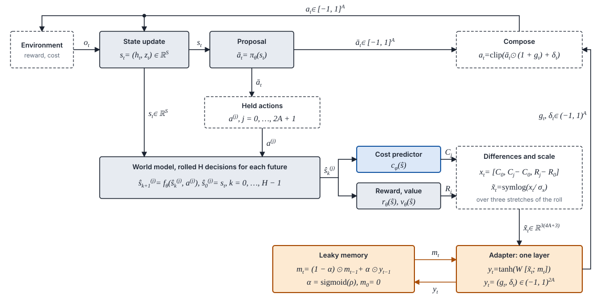
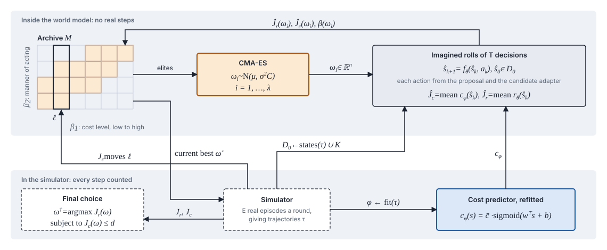

# Adapter architecture

This file records the architecture of the adapter and of the search that finds it, at the level of networks and the quantities passed between them, and the decisions that led to it. It builds on `brainStorming/adapterRecipeDesign.md`, which holds the recipe's earlier decisions and its terms (frozen agent, internal state, decision, look-ahead, steering). Where the two differ, this file is the later one.

The reasoning uses the labels of the design file, and one more:

- **Fact**: follows from an agent's architecture, from a paper we have read, or from arithmetic.
- **Observation**: seen in our own runs.
- **Assumption**: believed but untested. The assumptions are collected at the end.
- **Reported**: stated by a paper we found in a quick search and have not read in full.

## In plain words

Think of a confident driver who knows the way and ignores the red zones on the road, with a small co-driver beside them. The driver is the frozen agent. The co-driver is the adapter.

At each decision:

1. The driver proposes an action. The driver is never changed.
2. The world model imagines a few short futures: one in which the proposed action is held, others in which one action number is pushed up or down and held, and one in which the robot is given no action at all.
3. Each future is scored. A small cost predictor says how much cost it runs into, and the agent's own reward networks say how much progress it makes.
4. The co-driver reads how each push, and stopping, changes cost and reward, together with a memory of what it did a moment ago.
5. The co-driver scales the proposed action and adds a shift. That is the action the robot takes.

The memory is there to let it commit. Without it the co-driver forgets each moment, and the driver keeps pulling back towards the goal. In the searches run so far the co-driver has done as well without it (decision 6).

The co-driver is a small table of numbers, and with all of them at zero it does nothing. Evolution tries many tables inside the world model and scores each by the reward it keeps, less a price on the cost it runs into. Only the current best plays real episodes. Those set the price, and where that one stalls or fails becomes a test for the next round.

We supply the means: what the co-driver can see, that it can slow or shift, and that it can remember. Evolution finds how to use them.

## One decision

In the figures, grey boxes are the agent's frozen networks (weights $\theta$), blue is fitted on real episodes (weights $\phi$), orange is evolved (weights $\omega$), and dashed boxes have no weights.

**The frozen agent.** From the observation $o_t$ it forms its internal state and proposes an action:

$$s_t \in \mathbb{R}^S, \qquad \bar a_t = \pi_\theta(s_t) \in [-1, 1]^A$$

**The look-ahead.** $2A + 2$ actions are held. $a^{(0)}$ is the proposed action clipped to its limits. Each of $a^{(1)}, \dots, a^{(2A)}$ is $a^{(0)}$ with one action number set to $+1$ or to $-1$. The last, $a^{(2A+1)} = 0$, is the proposed action scaled to nothing. Each is rolled through the frozen world model, taking the most likely next state:

$$\hat s^{(j)}_0 = s_t, \qquad \hat s^{(j)}_{k+1} = f_\theta\big(\hat s^{(j)}_k,\, a^{(j)}\big), \qquad k = 0, \dots, H - 1$$

Cost and reward are added up along each future, with the value estimate standing for the reward after the last decision:

$$C^H_j = \sum_{k=1}^{H} c_\phi\big(\hat s^{(j)}_k\big), \qquad R^H_j = \sum_{k=1}^{H} r_\theta\big(\hat s^{(j)}_k\big) + v_\theta\big(\hat s^{(j)}_H\big)$$

The look-ahead numbers are the cost of holding the proposed action, and how much each other held action changes the cost and the reward:

$$x^H_t = \big[\, C^H_0,\ \ C^H_j - C^H_0,\ \ R^H_j - R^H_0 \,\big]_{j = 1, \dots, 2A + 1} \in \mathbb{R}^{4A + 3}$$

They are read in three stretches of one roll: the first 5 decisions, then what going on to 10 adds, then what going on to 15 adds.

$$x_t = \big[\, x^5_t,\ \ x^{10}_t - x^5_t,\ \ x^{15}_t - x^{10}_t \,\big] \in \mathbb{R}^{3(4A + 3)}$$

Each number is divided by its typical size and squashed:

$$\tilde x_t = \operatorname{symlog}(x_t / \sigma_x), \qquad \operatorname{symlog}(u) = \operatorname{sign}(u)\,\ln(1 + \lvert u \rvert)$$

**The cost predictor.** A logistic regression on the internal state, giving the expected cost of arriving in a state:

$$c_\phi(s) = \bar c \cdot \operatorname{sigmoid}(w^\top s + b_\phi)$$

**The memory.** One leaky unit per adapter output. Each keeps a fading average of that output, and how fast it fades is an evolved weight:

$$m_t = (1 - \alpha) \odot m_{t-1} + \alpha \odot y_{t-1}, \qquad m_0 = 0, \qquad \alpha = \operatorname{sigmoid}(\rho)$$

**The adapter.** One layer on the look-ahead numbers and the memory, with no added-on weights. Its output is a gain and a shift per action number, each kept between $-1$ and $1$:

$$y_t = \tanh\big(W\,[\tilde x_t\,;\, m_t]\big) = (g_t,\ \delta_t) \in (-1, 1)^{2A}$$

The memory averages this bounded output, so it stays between $-1$ and $1$ as well.

**The action taken.**

$$a_t = \operatorname{clip}\big(\bar a_t \odot (1 + g_t) + \delta_t,\ -1,\ 1\big)$$

An action number that the adapter leaves where it was is handed back exactly as the agent gave it, so that an episode at zero weights replays the unadapted agent's.

**The evolved weights** are $\omega = (W, \rho)$, and nothing else is searched:

$$n = 2A\,\big(3(4A + 3) + 2A\big) + 2A$$

That is 152 weights for two action numbers and 528 for four. At $\omega = 0$ the output $y_t$ is zero, the memory stays zero whatever $\alpha$ is, and $a_t = \bar a_t$.

## The search

The figure draws step 3 as the archive of decision 10, which was built and lost to the single score below.

1. **Candidates.** CMA-ES draws candidates around a centre, $\omega_i \sim \mathcal{N}(\mu, \sigma^2 C)$, starting from the adapter that does nothing.
2. **Imagined rolls.** Each candidate is rolled in the world model for $T$ decisions from the starting states $D_0$. Every candidate of a generation gets the same starting states and the same random numbers. A starting state comes with the memory that the adapter which played it had there, and the roll starts from that memory. The rolls give the candidate's imagined reward $\hat J_r(\omega_i)$ and cost $\hat J_c(\omega_i)$, and how far it moves the action, $\hat\Delta(\omega_i) = \operatorname{mean} \lvert a - \bar a \rvert$, all averaged over starting states and decisions.
3. **The score.** Reward and cost count as shares of the unadapted agent's on the same rolls: $\hat J_r(\omega_i) / \hat J_r(0) - p \cdot \hat J_c(\omega_i) / \hat J_c(0) - h \cdot \hat\Delta(\omega_i)$. The price $p$ and the hold $h$ start at 1 and are set by real episodes.
4. **Real episodes.** Only the current best $\omega^\ast$ plays in the simulator. It is the centre of the search. Its episodes $\tau$ do five things:
   - They show whether the imagined progress is real.
   - They move the price, up if they cost more than the limit and down if less: $p \leftarrow p \cdot \operatorname{clip}\big(J_c(\omega^\ast) / d,\ 1/1.5,\ 1.5\big)$. With decision 14, $J_c$ is taken over the episodes of the last three rounds, and the bound of 1.5 becomes one that falls from 2 at the first round to 1.26 at the last.
   - They move the hold, up if they earned a smaller share of the unadapted agent's reward than the rolls imagined and down if a larger one, by the ratio of the two shares and by no more than a factor of 1.5.
   - The next starting states are drawn from them and from the kept states: $D_0 \leftarrow \operatorname{states}(\tau) \cup K$. The kept states $K$ are those at which a cost was charged, the few decisions before them, and the whole episode of each round that earned the least.
   - The cost predictor is fitted again on every episode played so far.
5. **The final choice.** The adapters that played best are the finalists. They play more real episodes on the same seeds, and the choice is the one with the most reward within the cost limit: $\omega^\dagger = \arg\max_\omega J_r(\omega)$ subject to $J_c(\omega) \le d$. With decision 14 a finalist is judged on these further episodes alone.

Every real step is counted. Steps 1 to 3 use none.

## Notation

| Symbol | Meaning | Size or value |
|---|---|---|
| $t$ | Decision index. One decision is 2 simulator steps | 500 in a Safety-Gymnasium episode, 100 in a Meta-World episode |
| $o_t$ | Observation | Two camera images, or positions on Meta-World |
| $s_t$ | The frozen agent's internal state | $\mathbb{R}^S$, $S$ = 2,816 or 512 |
| $\bar a_t$ | The action the frozen agent proposes | $[-1, 1]^A$, $A$ = 2 or 4 |
| $a^{(j)}$ | Held actions: the proposed one, each action number pushed to $+1$ or $-1$, and the zero action | $2A + 2$ actions |
| $f_\theta$ | World model: the state one decision later | Frozen |
| $r_\theta$, $v_\theta$ | Reward predictor and value estimate | Frozen |
| $c_\phi$ | Cost predictor: expected cost of arriving in a state | $\phi = (w, b_\phi) \in \mathbb{R}^{S+1}$, $\bar c \approx 1.85$ |
| $H$ | Look-ahead length in decisions | 5, 10 and 15 |
| $C^H_j$, $R^H_j$ | Imagined cost and reward of future $j$ over $H$ decisions | One number each |
| $x_t$ | Look-ahead numbers over the three stretches of the roll | $\mathbb{R}^{3(4A+3)}$: 33 or 57 numbers |
| $\sigma_x$ | Typical size of each look-ahead number, measured on the unadapted agent's episodes | Measured, not searched |
| $\tilde x_t$ | Scaled look-ahead numbers | Same size as $x_t$ |
| $m_t$ | Memory: a fading average of the adapter's own output | $(-1, 1)^{2A}$ |
| $\alpha$ | How fast each memory follows the output. A memory that only fades lasts about $1/\alpha$ decisions | $(0, 1)^{2A}$ |
| $y_t = (g_t, \delta_t)$ | Adapter output: gain and shift | $(-1, 1)^{2A}$ |
| $\omega = (W, \rho)$ | All evolved weights | $n$ = 152 or 528 |
| $a_t$ | The action taken | $[-1, 1]^A$ |
| $\mu$, $\sigma$, $C$ | CMA-ES centre, step size and table of how the weights vary together. This $\sigma$ is not $\sigma_x$ | |
| $D_0$ | Starting states of the imagined rolls, from real episodes, each with the memory the adapter had there | 256 a generation |
| $K$ | Kept states: costly ones, the decisions before them, and each round's lowest-earning episode | Grows with every round |
| $T$ | Length of an imagined roll | 40 decisions, 20 on Meta-World |
| $\hat J_r$, $\hat J_c$, $\hat\Delta$ | Imagined reward and cost of a candidate, and how far it moves the action | One number each |
| $p$ | Price of cost in the score, set by real episodes | Starts at 1 |
| $h$ | Hold: the price of moving the action, set by real episodes | Starts at 1 |
| $\tau$ | The real episodes played in a round | |
| $J_r$, $J_c$ | Real reward and cost of an episode, averaged over episodes | |
| $d$ | Cost limit | 2 in a Safety-Gymnasium episode, 0.5 in a Meta-World episode |
| $\omega^\ast$, $\omega^\dagger$ | The current best, and the final choice | |

## The two agents

The recipe above the five pieces is the same for both agents. What stands behind each symbol differs.

| Piece | DreamerV3 | TD-MPC2 |
|---|---|---|
| State $s_t$ | 512 continuous numbers and 48 choices among 48, from images | One vector of 512 numbers, from positions |
| World model $f_\theta$ | Recurrent state-space model; the next state is a random draw | Latent dynamics network; no randomness |
| Reward $r_\theta$ | Of the arriving state | Of a state and an action together |
| Value $v_\theta$ | Critic, of a state | The mean of its Q-networks at the action its policy network would take, with their dropout off |
| Proposal $\pi_\theta$ | Actor network | Planner in real play; policy network in imagined rolls |
| Told the action taken | Yes, or its state drifts | No. The state is rebuilt from each observation, and the planner starts each plan from its last one |
| Episode | 500 decisions, goals repeat | 100 decisions, one success |

Two differences are in behaviour and not only in wiring.

- TD-MPC2 proposes by planning, which is too slow for thousands of imagined decisions, so in imagined rolls its proposal comes from its policy network. The search then scores the policy network with the adapter, and the planner with the adapter is what plays.
- TD-MPC2's world model is trained to roll 3 decisions ahead. The look-ahead asks it for 15 and an imagined roll for 20.

Two things in TD-MPC2's own code have to be switched off, or the same state does not give the same answer twice.

- Its Q-networks keep their dropout on when the agent plays, because they are held as a copy that `model.eval()` never reaches. The value the adapter reads runs the agent's own weights through a Q-network with the dropout off.
- Its arithmetic is written in TorchScript, which swaps in a faster version of a function after its first calls, with other last digits. Which decisions get which depends on everything computed before them, the adapter's look-ahead included, so an adapter at zero weights would not replay the unadapted agent. The swap is switched off.

## Decisions

### 1. What we want from the adapter

**Decision.** Eight things, which the later decisions are judged against.

| We want | What it means |
|---|---|
| Safe | Mean episode cost at or under the limit |
| Keeps the task | Reward near SafeDreamer's at that cost |
| No disasters | No single very costly episode |
| Quiet | It does nothing where nothing is wrong |
| Cheap to find | Within the budget of real steps, and small enough for CMA-ES |
| General | The same on any world-model agent, with no task knowledge |
| A dial | Several safety levels from one search |
| Something for evolution to find | The search, and not only the inputs, does part of the work |

**Why these pull against each other.**

- *Help against discovery.* The look-ahead hands the adapter the direction to move. The more it is handed, the better it works and the less the search can claim.
- *Reacting against committing.* An adapter that sees one decision at a time has no memory.
- *Correcting against taking over.* Getting round a hazard takes some navigating, which needs a sense of reward as well as of cost.
- *Small against expressive.* "Act only when" and "keep going the same way" both need more than a weighted sum.

### 2. Getting round a hazard is the adapter's job

**Decision.** When a hazard lies between the robot and the goal, the adapter finds the way round. Its part is small: pick a side, and hold that choice long enough to get past.

**Why.**

- **Fact:** the agent sees the hazard, which is why the cost predictor can read cost off its internal state. It has no reason to avoid it, because nothing in its training charged for it. At the next decision it proposes "towards the goal" again.
- **Fact:** the agent proposes afresh from every state and is good at reaching the goal from anywhere. Once the robot is off the line through the hazard, the agent finishes the job.
- **Observation:** steering loses its reward in some episodes and not a little in all. On PointGoal1, 11 of 40 episodes earn under 10 and the other 29 earn 19.7. At half strength, 8 of 40 are low and the rest earn 21.2, which is SafeDreamer's level (21.4 to 21.7). The unadapted agent has no low episode.
- **Observation:** which episodes are low is only partly the layout. Of the 11 low episodes at full strength and the 8 at half strength, 4 are the same seeds.
- **Observation:** on PointGoal1 the lost reward is stalls. Over 300 episodes the unadapted robot is stuck 0.5% of the time, where stuck means it covers under a tenth of its usual distance in 20 decisions. With steering it is stuck 16% of the time, and for over half the episode in 10% of episodes. At quarter strength it is stuck 31% of the time.
- **Assumption:** the stalls are in front of a hazard that lies between the robot and the goal.

**What this does not cover.**

- **Observation:** on PointButton1 nothing stalls. The cost that steering leaves there comes from the moving obstacles (11.0 of its 14.3, against 1.3 from the fixed zones), and the cost predictor gives such a hit a chance of 0.04 one decision before it happens. A robot that stands still is hit as well.
- The memory answers stalls. What PointButton1 needs is a cost predictor that sees a moving obstacle coming (decision 9).

**What others met.**

- **Fact** (Hsu et al. 2023): a safety filter that switches gives "control chatter and erratic motion" near the boundary, from overrides of a task policy that "persistently attempts to leave" the safe set.
- **Reported** (Mestres et al.; Notomista and Saveriano): a smooth safety filter on a goal-seeking controller creates resting points where the robot stops short of the goal, even with one convex obstacle. Steering is a smooth filter.
- **Reported** (Recovery RL) and **Fact** (Hsu et al. 2023): the usual fix is to train the task policy with the filter in place, so that it stops proposing the bad action. A frozen agent rules that out.
- **Fact** (Nightmare Dreamer): its safe policy is trained to imitate the task policy while lowering cost, so what takes over still heads for the goal. Our reward and value inputs play that part.
- **Reported** (Bidirectional Decoding): committing to a chunk of actions gives consistency and reacts worse when the world changes. Deciding at every step, with a preference for agreeing with the last choice, keeps both.

We found no method that removes the stall when the task policy is frozen. The search for one was quick.

### 3. How to commit is found by evolution

**Decision.** We do not write the rule for committing. The adapter is given the means, and the search finds the use.

**Why.**

- A stall is the outcome of a whole stretch of behaviour, and nothing is wrong at any single decision. Evolution ranks candidates by how the stretch turned out, so it needs no signal at each decision.
- "Pick a side and hold it" is a switch and not a slope. **Assumption:** gradient training, which follows smooth changes, does worse at it than evolution. The gradient baseline of the design file tests this.
- **Fact:** hand-written steering has no memory and reads cost only, so it cannot commit. An evolved adapter differs from it in more than the search: it also reads reward, has a gain, and has the memory. If it stops stalling, the credit goes to the search only if the same search without the memory still stalls, and the hand-written preference for the last choice does too. Both are run. That is the answer to the objection in the design file that the inputs do the work.

**What it needs.**

- A search fixes only what its score shows. The score has to be able to see a stall (decision 11).
- **Fact:** at zero weights the memory is zero and nothing reads it. The weights on the memory and the fade rates change no score until other weights have moved, so the search gets no early signal on them.

**Set aside.** *A hand-written preference for the last choice*: it is the rule we decided not to write. It stays as a baseline, as steering is.

### 4. Three responses, and what agnostic covers

**Decision.** The adapter must be able to redirect, delay and scale down, and must not be told which one a task needs.

**Why.**

| Environment | What is unsafe | The safe behaviour |
|---|---|---|
| Goal, level 1 | Fixed zones on the floor | Go round |
| Goal, level 2 | More zones, and objects that cost when touched | Go round in tighter space |
| Button | Zones, moving obstacles, wrong buttons | Go round, wait, and touch this one but not that one |
| Push | Zones and pillars, while pushing a box | Go round without losing the box |
| Meta-World | A region the gripper must not enter; a speed limit | A detour in three dimensions; slowing down |

- **Fact:** braking was the failure on PointGoal1 and is the correct answer to a speed limit. A recipe built around steering is therefore not general.

**What the recipe must not know.**

| Agnostic to | How |
|---|---|
| Agent family | Only the five pieces |
| What an action number means | Pushes per number; gain and shift per number |
| Kind of cost | A cost predictor on the state |
| Size of reward and cost | Shares of the unadapted agent's |
| How far ahead to look | Three stretches of one roll read at once (decision 8) |

**Limits this shows.**

- **Fact:** a re-rank over single pushes cannot slow a robot whose action numbers are wheels, because braking is both numbers down together. It needs a scaled-down copy of the proposed action among its candidates. The last action the look-ahead holds, the proposed action scaled to nothing, is that copy (decision 8).
- **Fact:** the cost has to be readable from what the agent observes, because the predictor reads the agent's internal state. On Meta-World the agent observes positions, so a cost must depend on those.
- **Fact:** a Meta-World episode succeeds once or fails. A detour that runs out of time loses everything, where on Safety-Gymnasium it loses one goal.

### 5. Components are means, not behaviours

**Decision.** Each behaviour we want is made possible by a component, and no component knows which way is safe. Every component does nothing at zero weights.

| Behaviour | Component that makes it possible | What the search decides |
|---|---|---|
| Redirect | A shift added to the action | Which way, how far, on what signal |
| Scale down | A gain that multiplies the action | How much, and when |
| Delay | The action scaled to nothing by the gain, and held | When to stop and when to go again |
| Commit | Memory of its own last output | Whether to keep going the same way |
| Quiet | No added-on weights, and inputs that are small away from danger | How strongly to answer small inputs |

**Why.**

- A component that already steers away from cost, with a strength for the search to set, is steering with a dial. That is a baseline and not the method.
- **Fact:** with zero as "off", how much a component is used is how far the search moves its weights from zero. No extra switch is needed.
- A finished adapter can be read by switching one component off and seeing what is lost. That shows which response a task needed without our having said so.
- **Fact:** with no added-on weights the output is zero whenever the look-ahead numbers and the memory are zero. No setting of the weights then changes the action by the same amount everywhere. Braking everywhere, the simplest form of the braking the pilot collapsed into, is outside what the adapter can express. Braking where a cost is expected is still inside it.
- **Observation:** the inputs are small away from danger and seldom exactly zero. Played steering changes the action at 97% to 98% of decisions, and by more than 0.1 at 37% to 52%. Quiet is a matter of degree, and how often the action is moved by more than 0.1 is reported for every adapter.

**Rests on.** The assumption that no task needs a constant change to the action. A speed limit that holds everywhere is the case to watch. There the cost of holding the proposed action is an input at every decision, and the memory can hold the gain down.

### 6. The main form is a residual with memory

**Decision.** The main form is the residual, a gain and a shift per action number, each kept between $-1$ and $1$, with memory. The re-rank over pushed actions is kept as the comparison the design file plans.

**Why.**

- **Fact:** gain and shift express all three responses of decision 4 on any robot. The re-rank needs its candidates changed first.
- **Fact:** a unit that feeds its own output back through a ceiling is a latch. With a weight above 1 on its own memory it has two resting values. Once pushed to one it stays there until the input pushes back hard. A blend of gain and shift cannot do that without the feedback.
- **Fact:** the ceiling has to be inside the loop, which is why the output passes through tanh. The clip on the action is outside it. Without the tanh the adapter and its memory are weighted sums, and the output either fades or grows without limit. With a fade rate of 0.5 and a weight of 1.5 on its own memory, a nudge of 3 decisions has grown to 11,000 by decision 40 and is past what a number can hold by decision 396.
- **Fact:** the bound of 1 is the size of the action's own limits, so it is not a value to set. With the gain at $-1$ the action is the shift alone, which reaches any action.
- **Observation:** committing takes memory, and taking one action outright is not enough. With hand-set weights the re-rank over pushed actions is stuck 23% to 33% of the time on PointGoal1, where steering is stuck 16% to 20%.
- The residual leaves more for the search to find than the re-rank's two weights.

**Set aside.** *A gain and a shift with no bound of their own*, as the design file has them: the loop then has no ceiling, and the memory cannot latch.

**Rests on.** The assumption that a search from zero finds the latch. A latch needs a weight above 1 on a unit's own memory, and the first candidates lie about 0.3 from zero.

**Found.** **Observation:** on PointGoal1 the search without the memory did at least as well as the search with it: reward 20.4 at a cost of 1.4 against 19.7 at 2.1 on fresh seeds, five searches each, and all five within the limit against three. On PointButton1 neither is within the limit. On the 16 further tasks, with the price of decision 14 and three searches each, the two cannot be told apart. With the memory the mean cost is within the limit on 7 tasks and in 21 of 48 searches, at a mean cost of 4.1 and 21% of the unadapted reward kept. Without it: 7 tasks, 25 of 48 searches, 4.3 and 21%. The memory earns more on 8 of the 16 tasks and costs less on 8, and the largest difference on any task is about twice its standard error. Whether any search found a latch has not been looked at.

### 7. The memory is one leaky unit per output

**Decision.** Each adapter output has a unit that keeps a fading average of it. The fade rate is an evolved weight.

**Why.**

- It is the smallest thing with a time scale. With a weight under 1 on its own memory a unit smooths its output over about $1/\alpha$ decisions. With a weight above 1 it latches (decision 6), and the fade rate is how fast it switches.
- **Reported** (Beer): small networks of leaky units with evolved time constants are the standard controller in evolutionary robotics.

**Set aside.**

- *GRU or LSTM*: their gates exist to keep gradients alive in training. Evolution has no gradients, so they add weights for nothing.
- *A few leaky hidden units*: the same idea with more freedom. This is the larger size in the design file's comparison of sizes.
- *The world model's own memory*: **Fact:** DreamerV3's state already carries the actions taken, so the raw-state adapter has memory without any being added. It belongs to that comparison.

### 8. The inputs: three stretches, a stopped action, squashed

**Decision.** The look-ahead is read over three stretches of one roll: decisions 1 to 5, 6 to 10 and 11 to 15. Beside the pushes it holds one more action, the proposed action scaled to nothing. The numbers pass through a symmetric log after being divided by their sizes.

**Why.**

- **Fact:** a roll to 15 decisions passes 5 and 10 on the way, so the three sums cost no further roll-outs.
- **Fact:** the sum to 10 decisions contains the sum to 5, so the three sums rise and fall together. The stretches hold the same information with less of it shared. That matters because the search has too few candidates to learn how weights vary together (decision 10).
- **Fact:** no push shows what scaling the whole action down does, so without the stopped action the gain has no input of its own. It costs one more future: 6 in place of 5 for two action numbers, and 10 in place of 9 for four.
- **Fact:** one fixed length is not general. Ten decisions is a tenth of a Meta-World episode, and a robot that cannot turn on the spot has to turn earlier.
- **Observation:** the look-ahead numbers are small most of the time and large near danger (decision 5).
- **Fact:** a symmetric log keeps sign and zero and tames large values, so the adapter can respond in proportion. DreamerV3 does the same to its own inputs.

### 9. The cost predictor stays a logistic regression

**Decision.** A logistic regression on the frozen state, fitted again as real episodes arrive.

**Why.**

- **Observation:** it scores 0.998 on PointGoal1 and 0.987 on PointButton1, and nearly as well from 20 episodes.
- **Fact:** it fits in minutes, so fitting it again each round is cheap.
- **Observation:** its expected cost is within 2% of the real cost on PointGoal1 and 6% on PointButton1. That matters because the look-ahead adds its outputs up.

**To try.** On PointButton1 it misses 18% of costly decisions, and the hits of moving obstacles are what remains of the cost there (decision 2). Three changes aimed at that: fit it on rolled-forward states as well, since those are what it is asked about; compare it with one small hidden layer; and average the look-ahead over a few drawn rolls in place of the most likely one, as the design file lists.

**Rests on.** The assumption that TD-MPC2's state also holds the cost. **Fact:** that state is trained to predict reward and value and not to rebuild the observation, so it may have dropped what does not affect reward. **Observation:** for a region the gripper must not enter it does: the predictor scores 0.969 to 1.000 on the four Meta-World tasks.

### 10. The search: CMA-ES with one score and a price

**Decision.** CMA-ES proposes candidates, and one score orders them: the reward share less a price on the cost share. The price is set by real episodes. An archive that keeps the best adapter for each cost level and each manner of acting was built to be the search, and lost to this one.

**Why CMA-ES.**

- **Fact:** it uses only the order of the candidates. **Observation:** the world model gets the order right and the levels wrong (rank agreement 0.82 to 0.88 by cost, with the imagined cost squeezed). A search that needs only the order is matched to that kind of model.

**Why a price set by real episodes.**

- No weight on cost is set by hand. What is set is the cost limit, which comes with the task. After each round the price moves by the ratio of the current best's real cost to the limit, by no more than a factor of 1.5.
- **Observation:** over the checks of the first searches the imagined cost level was about right (a share of 0.20 imagined against 0.16 real), and the order near the limit was not (rank agreement 0.20). Only real episodes can say where the limit lies.
- **Fact:** cost sits in a few episodes, so the mean of a handful is often far under the true one. An adapter is held to its mean cost plus the standard error, and the most the price changes shrinks each time the real cost crosses the limit.
- **Observation:** a search's own episodes still flatter its choice. The adapters chosen on PointGoal1 cost 0.3 to 1.1 over the 30 episodes of their search and 1.4 to 2.7 on fresh seeds.

**The archive, and how it lost.**

- It kept the adapter with the most imagined reward for each cost level, in levels that each halve the one above, and each share of the action's size kept. Every adapter it held was rolled again on each generation's starting states. The current best was the one with the most imagined reward at or under the limit level, the imagined cost level that real episodes say matches the cost limit, and the search started again from an adapter near that level after every round.
- It was tried for three reasons. Braking is the nearest safe behaviour, and the pilot's single ranking collapsed into it; an archive keeps braking adapters in their own cells. Which cells hold the best adapters shows which response a task needs. And it needs no hand-set weight on acting less.
- **Observation:** on fresh seeds its adapters earned 10.9 at a cost of 4.5 on PointGoal1, where the one score earned 19.7 to 20.8 at 1.4 to 2.7. On PointButton1 they cost 29.3, where the one score's cost 3.9 to 6.9.
- **Observation:** it held 2 to 6 adapters at a time and started the search again 12 to 100 times in 150 generations. A candidate seldom lands in a new cell or beats the adapter in its own, so most generations tell CMA-ES little, and the real cost of its current best was still 7 to 47 on PointGoal1 at the last rounds.
- **Observation:** the one score did not collapse into braking. In the rolls the adapters it chose keep 95% to 107% of the action's size on PointGoal1 and 87% to 101% on PointButton1.

**Found on tasks it was not developed on.** The recipe was fixed on PointGoal1 and PointButton1 and then run on the 16 other Safety-Gymnasium tasks, three searches each.

- **Observation:** on fresh seeds the chosen adapters cut 95% of the unadapted agent's cost and keep 26% of its reward, as means over the tasks. Their mean cost is within the limit on 3 of the 16 tasks, and 10 of the 48 searches are within it.
- **Observation:** against steering at twice its strength they earn more at less cost on 2 tasks, less at more cost on 3, and trade one for the other on 11. Against SafeDreamer's BSRP-Lag, which was trained for the limit, they earn less at more cost on 13.
- **Observation:** starting the search from steering changes nothing: within the limit on 2 of 16 tasks, 28% of the reward kept.
- **Observation:** the searches themselves ran above the limit. Over their last seven checks the current bests really cost 5.9 on average, and the chosen adapters cost 2.4 over their own 30 episodes and 5.3 over 300 fresh ones. Decision 14 is about why.

**Borrowed from evolutionary robotics.**

- **Reported** (Floreano and Mondada 1994): evolved obstacle avoidance met the same problem, that standing still is safe. Their fitness multiplied speed, straightness and distance from obstacles, so a robot that stops scores zero. This suits the single-ranking baseline, with no price to set.
- **Reported** (Koos, Mouret and Doncieux): a few real tests fit a model of where the simulation can be trusted, and the search prefers those regions.
- **Reported** (Cully et al.): build the archive in simulation, then use a handful of real trials to find the cell that works. This is a way to check a whole archive without playing every cell.
- **Reported** (Jakobi): randomise what the simulation gets wrong, so evolution cannot exploit it. Drawn rolls already do this.

**Cost.**

- More weights (152 and 528) than the "tens" of the design file, and more room for an adapter to look good only in imagination.
- **Fact:** with 16 candidates a generation, CMA-ES takes about 2,900 generations to learn how 152 weights vary together, and about 35,000 for 528. The first searches ran 75. Over that many the search is close to one that treats every weight alike and adapts only its step size. Imagined generations use no real steps, so more of them between two rounds cost computing time only.
- **Reported** (Ros and Hansen): a CMA-ES that keeps one number per weight, and none for pairs of weights, learns about $n/3$ times faster. It is the form to use for 528 weights.
- A generation keeps the 256 starting states of the first searches. More are drawn only if one adapter's score changes more between two generations' states than candidates differ within one.

### 11. The score has to see a stall

**Decision.** Some imagined rolls start from states of the episode in which the current best earned least, as others start from states in which it really ran up a cost. Every roll starts with the memory the adapter had at that state.

**Why.**

- **Observation:** rolls of 40 decisions from the unadapted agent's states imagine steering keeping 86% of the reward on PointGoal1, where it really keeps 61%.
- **Fact:** a roll of 40 decisions from where the unadapted agent goes cannot see a stall that lasts hundreds of decisions. One that starts in the stall can.
- **Fact:** a stall does not have to be detected. The episode of each round that earned the least is kept whole, which needs no measure of standing still and no threshold. The scoreboard's measure of being stuck reads the robot's position from the simulator, which the recipe may not use. A threshold on reward against the unadapted agent would not work either: steering's good episodes earn 19.7 to 21.2 where the unadapted agent earns about 27, so all of them would count as stalls.
- **Fact:** a roll that starts with an empty memory cannot show a failure the memory caused. A latch that never lets go looks like commitment over 40 decisions, and is a robot held to one side for the rest of a 500-decision episode. The memory is bounded and holds the adapter's own output, so the memory of the adapter that played is a fair start for any candidate.

**Borrowed.**

- **Reported** (Ng and Jordan): giving every candidate the same starting states and random numbers turns a noisy comparison into a fair one. Its known risk is fitting those particular cases, which is why new ones are drawn each generation.
- **Reported** (Janner et al.): model error grows with the length of a roll, so many short rolls that branch from real states stay trustworthy.

**Rests on.** The assumption that the world model is right about stalled states. The unadapted agent never stalls, so the model was never trained on one.

**Found.** **Observation:** DreamerV3's world model is about right there. From the states of steering's own episodes where it really earned nothing over the next 40 decisions, the model imagines 0.1 to 0.3, against 1.7 to 1.9 for the unadapted agent from the same states. Over all starting states imagined and real reward agree in rank at 0.83 on PointGoal1 and 0.69 to 0.73 on PointButton1. Cost agrees far less: 0.05 on PointGoal1 and 0.28 to 0.39 on PointButton1.

### 12. One recipe, two agents

**Decision.** Everything above the five pieces is the same for DreamerV3 and TD-MPC2. The differences are in the table under "The two agents". On TD-MPC2 an imagined roll is 20 decisions, a fifth of an episode, and CMA-ES keeps one number per weight.

**Why.**

- **Fact:** TD-MPC2 has a policy network beside its planner, a deterministic latent dynamics network, a reward network on state and action, and Q-networks. Each of the five pieces can be written from these.
- **Fact:** its planner is too slow to ask at every imagined decision, so imagined rolls use the policy network.
- **Fact:** its world model is trained to roll 3 decisions ahead. The look-ahead's 15 and an imagined roll's 20 are far past that.
- **Fact:** its planner starts each plan from its last one, moved on by a decision, and is not told the action taken. With an adapter, the last plan was for an action the robot did not take.

**Found.**

- **Observation:** for the unadapted agent, rolls of 3 to 40 decisions agree with what really followed: on mw-reach 753 imagined against 755 real over 40 decisions, from the states that earned least. The policy network stands in well for the planner.
- **Observation:** for an adapter that moves the action far, the rolls are too hopeful. Steering really keeps 28% of the reward on mw-reach and is imagined keeping 55% to 61% in rolls of 10 to 40 decisions, and at 40 decisions it is imagined running up the unadapted agent's whole cost where it really ran up none. After their first 10 generations the searches' current bests were imagined keeping 84% to 99% of the reward and really kept less than two thirds in 19 of 20 searches.
- **Observation:** the searches recovered from that on three of four tasks without any change, through the starting states kept from the lowest-earning episodes (decision 11). On mw-reach and mw-button-press-topdown they then end where the searches of decision 13 do.
- **Observation:** on fresh seeds the adapters chosen with the hold and the small first step of decision 13 keep 97% of the reward on mw-reach and on mw-button-press-topdown and 93% on mw-window-open, with the cost cut by 90% to 99% and every search within the limit. Steering at half strength keeps 25% to 82% there. On mw-push no adapter both pushes the puck and stays out of the region: the chosen ones keep 10% of the reward.

**Rests on.**

- The assumption that the policy network and the planner agree closely enough that an adapter found with one works with the other.
- The assumption that its world model stays usable over 15 and 40 decisions.
- The assumption that a plan started from one the adapter overrode is no worse.

### 13. A second price, on moving the action

**Decision.** The score also charges for how far a candidate moves the action, at a price the real episodes set: the hold (the search, steps 3 and 4). On TD-MPC2 the first candidates lie 0.05 from zero, where on DreamerV3 they lie 0.3.

**Why.**

- **Observation:** TD-MPC2's rolls are right about an adapter that moves the action little and too hopeful about one that moves it far (decision 12). A score of imagined reward and cost cannot tell the two apart.
- **Fact:** how far the action is moved is measured in the rolls and needs nothing from the simulator. No weight on it is set by hand. The hold rises while the real episodes earn a smaller share of the unadapted agent's reward than the rolls imagined, and falls while they earn a larger one.
- **Observation:** 0.3 from zero, the first candidates move each action number by 0.27 to 0.59 on a scale of $-1$ to $1$. 0.05 from zero they move it by 0.06 to 0.13. **Assumption:** TD-MPC2's model saw few actions far from its planner's choice in training.

**Found.**

- **Observation:** on mw-window-open, the task where the search of decision 12 did worst among those it could do, each of the two helps alone and both together do best. On fresh seeds: neither 1136 at a cost of 0.43, the small first step alone 1419 at 0.27, the hold alone 1400 at 0.29, both 1479 at 0.33, with the searches differing least from one another (a standard deviation of 43 against 88 to 142). The unadapted agent earns 1598 at 3.37.
- **Observation:** on mw-reach and mw-button-press-topdown both together change nothing (1814 against 1816, and 1305 against 1298). On mw-push both together leave the failure a failure (171 against 65, of 1791).
- **Observation:** where the hold ended follows how hard the task was to keep right: 1.3 to 1.6 on mw-reach, 1.4 to 2.1 on mw-button-press-topdown, 2.7 to 5.5 on mw-window-open, and 14 to 324 on mw-push, where the price of cost ran away as well.
- **Observation:** on PointGoal1 both together do no harm and no good: 19.0 at a cost of 1.9 against 19.7 at 2.1 for the same adapter without them.

**Rests on.** The assumption that moving the action less is what makes the rolls right. The two shares the hold compares are not measured alike: the imagined one comes from starting states of which half are costly or from the lowest-earning episode, the real one from whole episodes.

### 14. The price follows several rounds, and loosens on a schedule

**Decision.** Three changes to how real episodes are read, made after decision 10's result on the 16 further tasks. The price follows the cost over the episodes of the last three rounds. The most it changes at a round falls with the number of rounds done, from a factor of 2 to 1.26, and no longer with crossings of the limit. A finalist is judged on 40 further episodes alone.

**Why.**

- **Observation:** cost sits in rare episodes. On fresh seeds, 4% to 67% of a chosen adapter's episodes cost anything, the median episode costs nothing for 35 of 40 adapters, and the costliest episode costs 38 to 730. Ten episodes seldom hold one.
- **Observation:** the price was stuck. Its bound was halved, on a log scale, each time the judged cost crossed the limit. With costs like these the crossings are chance, four or five a search, so from about the eighth round the price moved by 1% to 2%. Over the last seven rounds three in four were judged over the limit and the price could not follow.
- **Fact:** a bound that falls with the rounds done cannot be used up by chance crossings, and still lets the price settle.
- **Fact:** an adapter becomes a finalist because its own round went well. Counting those episodes again in the final choice flatters it.

**Rests on.** The assumption that the adapters of three rounds in a row are alike enough for their episodes to be read together.

**Found.** These runs came after the further tasks' scoreboards had been seen, so those tasks are not untouched for this decision.

- **Observation:** on the two development tasks, five searches each on fresh seeds. PointGoal1: 17.8 at a cost of 1.6 with 4 of 5 searches within the limit, against 19.7 at 2.1 with 3 of 5 for decision 10's search. PointButton1: 3.1 at 6.1 against 2.4 at 3.9, with no search within the limit either way.
- **Observation:** on the 16 further tasks, three searches each on fresh seeds, the mean cost is within the limit on 7 tasks where it was on 3, and 21 of the 48 searches are within it where 10 were. The mean cost over the tasks falls from 5.3 to 4.1, and the share of the unadapted reward kept from 26% to 21%.
- **Observation:** all of the gain is on the 11 Goal and Push tasks: mean cost 3.3 to 1.8, within the limit on 7 tasks where it was on 3, reward kept 37% to 30%. On the 5 Button tasks nothing changes: a cost of 9.2 against 9.9, about 1% of the reward kept, and the price at its ceiling at the end of 14 of the 15 searches. As on PointButton1, no adapter found both presses the buttons and stays within the limit.
- **Observation:** the baselines still stand. Against steering at twice its strength the chosen adapters earn more at less cost on 1 task, less at more cost on 3, and less at less cost on 10. Steering at twice its strength is within the limit on 6 tasks and keeps 31% of the reward. BSRP-Lag is within the limit on 13 and keeps 62%, and the chosen adapters earn less at more cost than it on 12.
- **Observation:** a finalist's own episodes still read low. The chosen adapters cost 2.6 over their own 40 further episodes and 4.1 over 300 fresh ones, where decision 10's cost 2.4 and 5.3. Of the 28 searches that called their choice within the limit, 18 were.
- **Fact:** a search plays 310,000 simulator steps where decision 10's plays 250,000.

## What it changes in the code

- `adapterRecipe/adapter.py`: the residual reads a memory and has fade weights; it takes the memory in and gives the next one back. Its output passes through tanh, and the added-on weights go.
- `adapterRecipe/look_ahead.py`: the stopped action as one more held future, sums over three stretches of one roll with a size measured for each, and the symmetric log after the division by sizes.
- `adapterRecipe/episodes.py` and `adapterRecipe/frozen_agent.py`: the memory is carried from one decision of an episode to the next and set to zero at each new episode. It is saved with the episode, one entry per decision.
- `adapterRecipe/imagine.py`: the memory is carried through an imagined roll, and starts from the memory saved with each starting state. That is zero for a state of the unadapted agent.
- `adapterRecipe/search.py`: the score with its price, and with `--hold` the second price on moving the action; each round's lowest-earning episode kept among the starting states as costly states are. `--archive` runs the archive of decision 10 in place of the score. `--window`, `--fading` and `--fresh` are decision 14.
- `adapterRecipe/frozen_tdmpc2.py`: the five pieces for TD-MPC2 and its Meta-World simulator, with the two switches under "The two agents".
- `adapterRecipe/cma.py`: a form that keeps one number per weight, for four action numbers.
- The check that zero weights replay the unadapted agent exactly must still pass, with the memory staying at zero.

## Order of work

Each step can end the ones after it, so they are run in this order.

1. The adapter with its memory, and the check that zero weights replay the unadapted agent.
2. Imagined against real reward for rolls that start in a real stall. If the world model is wrong there, no score can see a stall.
3. The single-score search on stalled starting states, with and without the memory. If the memory changes nothing, the archive is not built around it.
4. The archive.

On TD-MPC2, imagined against real cost and reward by length of roll comes before any search.

## Assumptions to test

| Assumption | Decision | What would test it | Found |
|---|---|---|---|
| Steering's stalls are in front of a hazard | 2 | Where the robot is when it is stuck, and how near the nearest hazard is | Not tested |
| A search from zero finds the latch | 3, 6 | A search on stalled starting states, with and without the memory | The search without the memory did as well on PointGoal1 and on the 16 further tasks (decision 6). No adapter's weights were read for a latch |
| Evolution commits better than gradient training | 3 | The same adapter trained by gradient descent through the world model | Not tested |
| No task needs a constant change to the action | 5 | A search with and without the added-on weights | Not tested |
| The stopped action gives the gain what it needs | 8 | A search with and without that future, on a task where slowing is the answer | Not tested |
| The world model is right about stalled states | 11 | Imagined against real reward for rolls that start in a real stall | About right on DreamerV3 (decision 11) |
| A manner-of-acting axis keeps the search from collapsing into braking | 10 | The archive against a single ranking, same budget | The single score did not collapse, and the archive lost to it (decision 10) |
| 256 starting states are enough to order a generation's candidates | 10 | How much one adapter's score changes between two generations' states, against how much candidates differ within one | Not tested |
| The limit level settles | 10 | Its path over the rounds of a search, and the real cost of the current best at each | No: the real cost of the archive's current best stayed far from the limit |
| Reading three stretches does no worse than the best single length | 8 | Steering and a search at one length and at three stretches | Not tested |
| TD-MPC2's state holds the cost | 9, 12 | The cost-predictor test on TD-MPC2 | Yes: 0.969 to 1.000 on four tasks |
| TD-MPC2's policy network and planner agree closely enough | 12 | How far their actions differ on the same states, and an adapter found with one played with the other | Adapters found with the policy network work with the planner on three of four tasks (decision 12) |
| TD-MPC2's world model stays usable over 15 and 40 decisions | 12 | Imagined against real cost and reward by length of roll | Near the unadapted agent, yes. For an adapter that moves the action far it is too hopeful (decision 12) |
| Moving the action less is what makes TD-MPC2's rolls right | 13 | Imagined against real reward for adapters that move the action by different amounts | Not tested directly. The hold and the small first step each help on mw-window-open (decision 13) |
| A plan started from one the adapter overrode is no worse | 12 | The planner started afresh at every decision against started from its last plan, both with an adapter | Not tested |
| The adapters of three rounds in a row are alike enough to read together | 14 | The cost of a round's episodes against the cost of the two rounds before it, for the same search | Not tested. The price read this way brings more searches within the limit (decision 14) |
| An adapter on the action can keep a Button task within the limit | 10, 14 | A longer search, or an adapter that reads more than the look-ahead | No adapter found does, on 6 Button tasks, with either way of setting the price |
